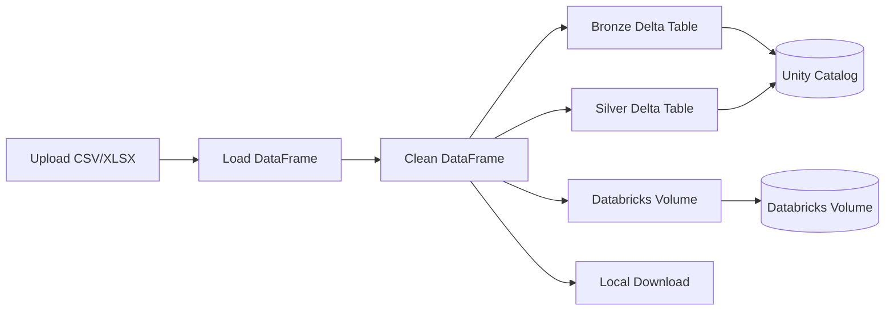

# flow-bricks

Medallion Data Lakehouse manager built with Streamlit and the Databricks SDK.
Upload local CSV/Excel files, clean them, and persist results to Databricks
Unity Catalog (Bronze/Silver tables) and Volumes, with optional local download.

## Features

- Connect to a Databricks workspace via personal access token
- Load CSV, XLS, and XLSX files into pandas DataFrames
- Clean data: drop null rows, remove duplicates, normalize column names
- Write raw data to a Bronze Delta table and cleaned data to a Silver Delta table
- Upload cleaned files to a Databricks Volume
- Download cleaned files locally

## Architecture



## Quick start

```bash
cp src/.env.example src/.env
# fill in Databricks credentials
just dev
```

App runs at <http://localhost:8501>.

## Environment variables

| Variable | Description |
| --- | --- |
| `DATABRICKS_HOST` | Databricks workspace URL |
| `DATABRICKS_TOKEN` | Personal access token |
| `DATABRICKS_CATALOG` | Unity Catalog name (default `main`) |
| `DATABRICKS_BRONZE_SCHEMA` | Bronze schema (default `bronze`) |
| `DATABRICKS_SILVER_SCHEMA` | Silver schema (default `silver`) |
| `DATABRICKS_VOLUME_PATH` | Volume path for cleaned files |

## Commands

- `just dev` - sync deps and run Streamlit with auto-reload
- `just run` - run Streamlit in headless mode
- `just test` - run pytest
